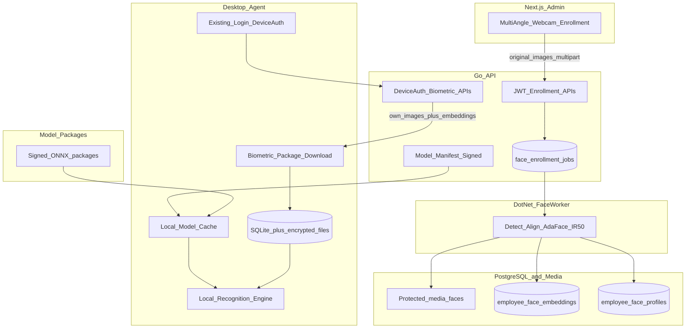
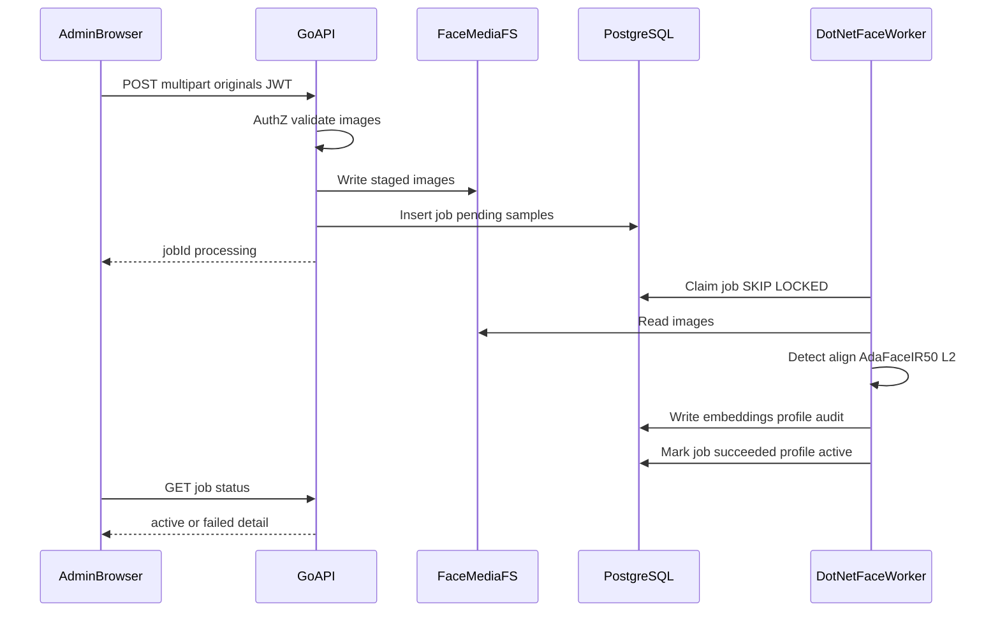
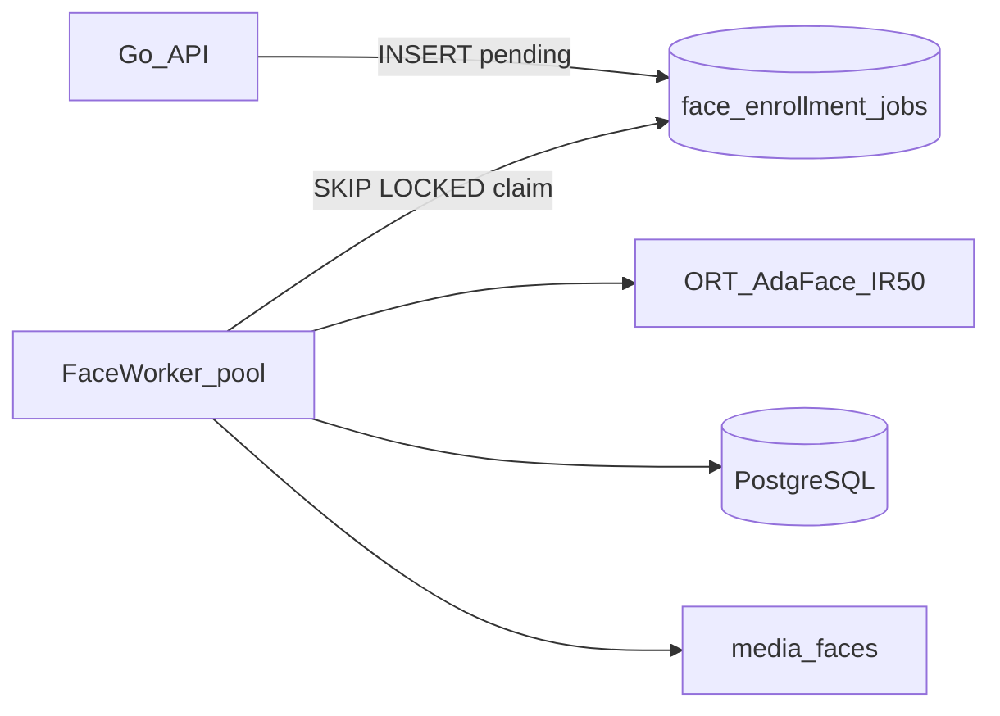
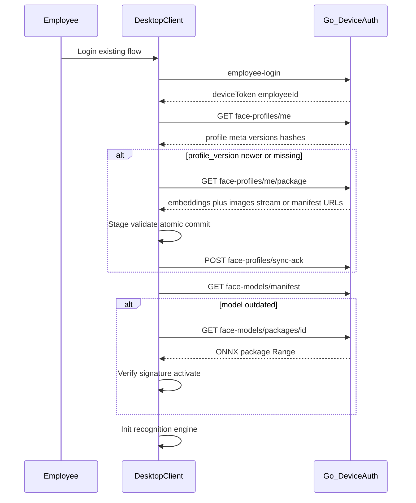
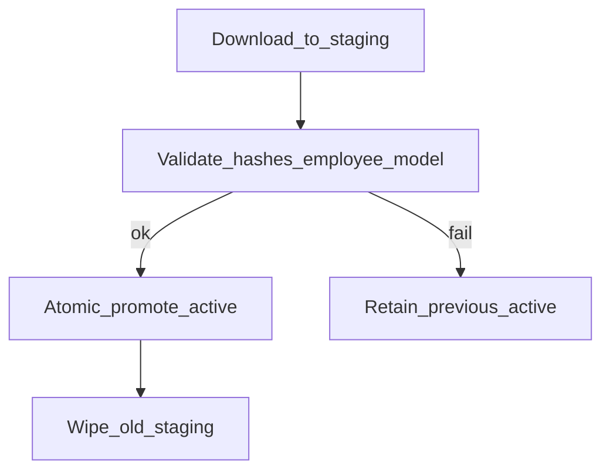
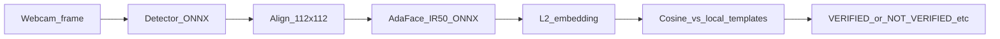
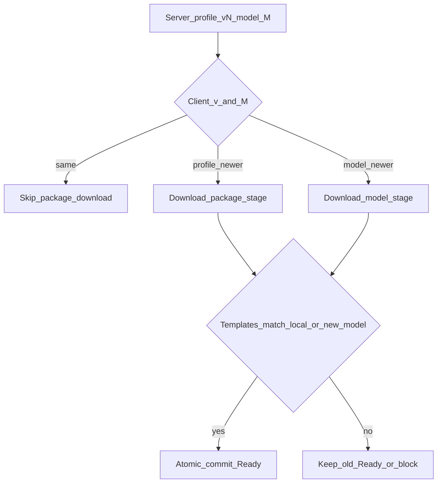
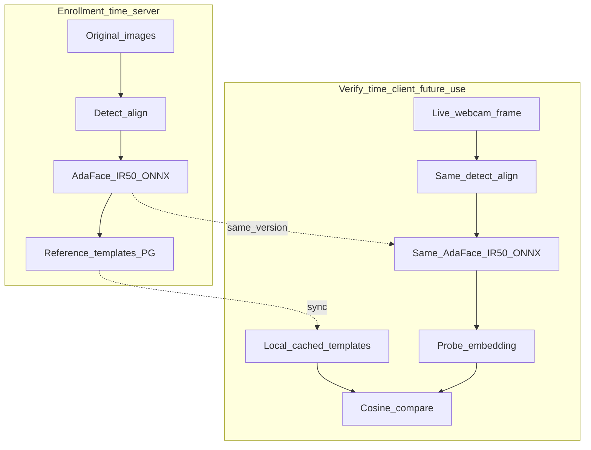

# Alpha AI Tracker — Face Recognition Enrollment & Local Engine Plan

> **Status:** Planning only (no implementation in this document’s delivery).  
> **Branch audited:** `agentAttendance` (filesystem-verified).  
> **Last updated:** 2026-11-12  
> **Scope:** Multi-angle browser enrollment → server embedding generation → DeviceAuth biometric package + ONNX model download → local storage → local recognition engine ready.  
> **Out of scope (future):** clock-in/out, breaks, attendance state machine, attendance dashboards/policies/reporting, continuous presence monitoring, automatic clock-out. Liveness/anti-spoofing is documented only as a future security extension.

---

## 1. Executive summary

This plan introduces **centralized face enrollment and biometric management** with **distributed local face recognition readiness** on the employee desktop agent.

### Required end-to-end workflow (canonical)

1. Admin opens `/employees`, starts multi-angle webcam enrollment, and uploads **original images** (not client-generated embeddings).
2. Go API accepts the job; a dedicated **.NET FaceWorker** (ONNX Runtime) detects, aligns, embeds with **AdaFace IR-50** (subject to commercial licensing approval), and persists embeddings + metadata in PostgreSQL.
3. Employee logs into the Avalonia client; DeviceAuth identifies them.
4. Client downloads **only that employee’s** biometric package (original enrollment images + embeddings + profile/model metadata) and the required ONNX model package (if missing/outdated).
5. Client stores data locally (SQLite + encrypted files), validates, and activates atomically.
6. Client initializes the local recognition engine (detector + AdaFace ONNX + reference templates). After that, recognition can run **offline**.

### Architectural principles

| Principle | Decision |
|-----------|----------|
| Authority | Server owns original images and authoritative embeddings |
| Browser role | Capture + quality UX + upload images only |
| Inference runtime | ONNX Runtime (.NET) on server worker and desktop; no Python production dependency |
| Recognition mode | **1:1 verification** against the authenticated employee’s templates only |
| Profile download | Never fleet-wide; DeviceAuth employee context only |
| Attendance | **Deferred** — this plan stops at “recognition engine ready” |
| Scale | Design for 1,000+ agents; reuse existing admission/jitter patterns |

---

## 2. Current architecture assessment

### Stack (existing)

| Layer | Tech | Notes |
|-------|------|-------|
| Web | Next.js / React / TypeScript | Admin UI; employees at `/employees` |
| Server | Go (Echo), PostgreSQL, Redis | JWT admin APIs; DeviceAuth sync APIs; Asynq for non-AI sweeps |
| Client | Avalonia / .NET, SQLite | Windows + Linux; login → DeviceToken → background workers |

### Reusable building blocks (verified paths)

| Concern | Reuse |
|---------|--------|
| Admin employees UI | [`web/src/app/(app)/employees/page.tsx`](../web/src/app/(app)/employees/page.tsx), Radix dialogs |
| RBAC | [`server/internal/services/rbac_service.go`](../server/internal/services/rbac_service.go) module `users` |
| JWT routes | [`server/internal/router/router.go`](../server/internal/router/router.go) `protected` group |
| DeviceAuth | [`server/internal/middleware/device_auth.go`](../server/internal/middleware/device_auth.go); `syncGroup` |
| Employee login | [`client/ViewModels/MainViewModel.cs`](../client/ViewModels/MainViewModel.cs) `LoginAsync` → `POST /auth/employee-login` |
| Pull-after-login | [`client/Services/ScheduleCacheService.cs`](../client/Services/ScheduleCacheService.cs) |
| Private media on disk | Screenshots: migration [`065_screenshots.sql`](../server/migrations/065_screenshots.sql), `SCREENSHOTS_DIR`, JWT ServeContent |
| Protected/large downloads + concurrency | Releases: `RELEASES_DIR`, `GET /api/v1/downloads/:assetId`, `RELEASE_DOWNLOAD_MAX_CONCURRENT` + `Retry-After` |
| SQLite access | [`client/Storage/DatabaseSchema.cs`](../client/Storage/DatabaseSchema.cs), [`SqliteLogStore.cs`](../client/Storage/SqliteLogStore.cs) |
| Scale admission | Sync/login jitter, 429/503 + `Retry-After` (AGENTS / `prompt.md`) |
| Single Postgres | Mandatory — no second DB |

### Existing attendance (context only — not extended here)

Current `/attendance` is **derived on read** from OS `session_events` + shifts/holidays. There is **no** face punch or clock-in API. This plan does **not** change that system.

---

## 3. Current face implementation assessment

Filesystem-verified on `agentAttendance`:

| Artifact | Status |
|----------|--------|
| `server/migrations/068_employee_face_embeddings.sql` | **Not present** (Cursor index may stale-list it; disk `Test-Path` = false). Latest migration: **067** |
| Server face handlers/services/repos/DTOs | **Absent** |
| Web enroll dialog / face-enrollment lib / face API client | **Absent** |
| Client Face services / OpenCV / ONNX / webcam | **Absent** (empty `client/Services/Face/` directory only) |
| Leftovers | Empty `web/public/face-api/`, empty `server/media/faces/LIN-1`, orphan `node_modules/@vladmandic/face-api` (not declared in `package.json`) |

**Conclusion:** Face recognition is **greenfield**. Do not assume or resurrect a prior unfinished FaceNet-in-browser design (client-side 128-D embeddings). That approach violates “server generates authoritative embeddings” and would break ONNX parity with the desktop agent.

**Next migration number:** `068_…` onward.

---

## 4. Proposed target architecture

### Central principle

**Centralized enrollment & embedding authority + employee-scoped biometric sync + local ONNX recognition readiness.**

### Component responsibilities

| Component | Owns |
|-----------|------|
| Next.js `/employees` | Multi-angle capture UX, quality gates, retake, upload originals |
| Go API | AuthZ, validation, job creation, metadata CRUD, protected downloads, model manifest |
| .NET FaceWorker | Detect, align, AdaFace IR-50 embed, quality/duplicate checks, persist via DB/API contract |
| PostgreSQL | Profiles, embeddings, jobs, audit, model version rows |
| Private filesystem | Enrollment images; signed ONNX packages |
| Desktop agent | Post-login sync, model cache, encrypted local store, engine init |

---

## 5. Canonical product workflow (Steps 1–6)

### Step 1 — Browser multi-angle enrollment

**Location:** extend existing `/employees` (row menu and/or employee detail).

**Capture sequence (guided, quality-gated):**

| Pose ID | Guidance |
|---------|----------|
| `front` | Face camera squarely |
| `left_slight` / `left` | Turn left |
| `right_slight` / `right` | Turn right |
| `up` / `down` | Slight pitch |
| `front_return` | Return to front |
| optional extras | Natural expression variation if quality scoreboard requires |

**Target:** ~8–12 quality-approved samples across poses (tunable after AdaFace IR-50 eval; reject extreme profile if it harms template quality).

**UI must provide:** live preview, bounding box, pose guidance, lighting/blur/size indicators, multi-face rejection, progress, per-sample retake, completion status.

**Reject:** no face, multiple faces, severe blur, extreme exposure, wrong pose, face too small.

**Upload:** original approved images (JPEG/PNG/WebP) to Go — **no authoritative embedding generation in the browser**.

Optional: browser may compute **non-authoritative** quality heuristics (blur variance, face box size) to reduce bad uploads; server re-validates.

### Step 2 — Server receives images and generates embeddings

1. JWT authenticate admin; authorize enroll permission for target employee.
2. Validate employee exists and is eligible.
3. Validate image type/size/count/pose labels.
4. Store originals under protected `FACE_MEDIA_DIR` (default `media/faces/{employeeId}/{jobId}/`).
5. Enqueue `face_enrollment_jobs` (`pending`).
6. FaceWorker claims job (`FOR UPDATE SKIP LOCKED`), runs detect → align → AdaFace IR-50 → L2 normalize.
7. Persist embeddings with employee, sample, model, preprocess, enrollment versions.
8. Evaluate template quality; optional near-duplicate scan across other employees’ templates (1:N **admin conflict check only**, not runtime identification).
9. Mark profile `active` only after successful DB commit; audit row written.
10. Enrollment UI polls status: `pending` → `processing` → `active` | `failed` | `needs_more_samples` | `duplicate_warning`.

Go API **must not** block HTTP on ONNX inference.

### Step 3 — Employee desktop login → biometric package request

After existing login succeeds and `DeviceToken` is stored:

1. Client uses DeviceAuth (`Authorization: Device <token>`).
2. Server resolves **employee_id** from token (not from client-supplied ID).
3. Client requests biometric package for **self** only.
4. Package includes: profile ID, versions, model IDs, preprocess/normalization config, embeddings/templates, **original enrollment images** (product requirement — see §9), integrity hashes.

### Step 4 — Download and prepare AI models locally

- Fetch signed **model manifest** (detection + alignment + AdaFace IR-50 recognition).
- If local cache matches manifest digests → skip download.
- Else download packages from protected DeviceAuth (or device-scoped signed URL) endpoints with Range resume, jitter, and concurrency-aware `Retry-After`.
- Verify checksum + signature **before** load.
- Keep previous working model until new package validates.
- Never activate a model incompatible with stored template `model_version`.

### Step 5 — Store biometric data locally

- Extend existing SQLite (no second DB).
- Images on disk under LocalAppData (encrypted); embeddings/metadata in SQLite (encrypted columns or envelope-encrypted blobs).
- OS key protection (Windows DPAPI / Linux secret service or equivalent) — **keys not beside ciphertext**.
- Atomic: stage → validate → commit; retain prior profile on failure.

### Step 6 — Initialize local recognition engine

**Technical distinction (mandatory clarity):**

| Artifact | Role |
|----------|------|
| Enrollment images | Original source photos (audit / admin / optional local archive) |
| ONNX recognition model | **Pretrained** AdaFace IR-50 — converts an aligned face crop → embedding |
| Stored embeddings | **Reference templates** produced at enrollment time |
| Live webcam frame | Detected → aligned → embedded **at verify time** → compared to templates |

**Do not** “train AdaFace on login.” The model is fixed; templates are the employee’s reference vectors.

Engine ready when: compatible model loaded, templates loaded, preprocess versions match, self-test embedding of a synthetic/fixture crop succeeds (optional), status = `RecognitionReady`.

After successful sync, **offline** engine init must work without API reachability.

---

## 6. AI model selection and licensing

### Requested recognition candidate

**AdaFace IR-50** — production candidate **subject to commercial licensing approval**.

| Attribute | Documented fact | Must measure / verify in Phase 1 |
|-----------|-----------------|----------------------------------|
| Architecture | IR-50 backbone, 112×112 input | Exact ONNX graph ops vs ORT version |
| Embedding dim | 512 (AdaFace family) | Byte layout / float32 endianness parity |
| Normalization | L2-normalized embeddings; cosine = dot product | Identical preprocess on worker and agent |
| Published metrics | UniFace/adaface-onnx tables report IR-50 WebFace4M IJB-B/IJB-C TAR@FAR=0.01% (e.g. ~95.44% / ~96.98% in those publications) | **Do not treat as our FAR/FRR**; calibrate thresholds on internal office-webcam set |
| ONNX | Community exports exist (e.g. yakhyo/adaface-onnx); upstream AdaFace historically did not ship official ONNX | Pin a **hash-locked** ONNX we export or vendor; verify numerical parity vs PyTorch reference |
| Code license | AdaFace GitHub: MIT | Confirm exact commit |
| Weight / training-data license | **Not automatic from MIT code.** WebFace* training corpora may impose separate constraints | **Legal counsel approval required before bundling weights in installer or server packages** |
| .NET / Win / Linux | ONNX Runtime supports both | CPU latency/RAM on target office PCs |

### Detection / alignment (must also be license-cleared)

Do **not** ship InsightFace SCRFD/buffalo packs without a commercial InsightFace license (pretrained models are research/non-commercial per InsightFace README/maintainer statements).

Preferred Phase 1 evaluation set for detector/landmarks:

- RetinaFace (MIT-licensed implementations) or OpenCV YuNet / MediaPipe Face Landmarker (Apache-2.0) — verify **weights** provenance separately.
- Same detector package must ship to FaceWorker and desktop.

### Explicitly not default commercial picks without license purchase

| Package | Issue |
|---------|--------|
| InsightFace buffalo_l / antelopev2 / SCRFD pretrained | Non-commercial research pretrained terms |
| EdgeFace (Idiap) | Upstream **CC BY-NC-SA 4.0** — not a free commercial default |

### Final recommendation (engineering)

1. **Proceed with AdaFace IR-50 ONNX** as the technical design center.
2. **Gate production distribution** on written legal approval of weights + training-data provenance.
3. Fallbacks if counsel blocks WebFace-trained weights: (a) InsightFace commercial license, (b) retrain AdaFace/ArcFace on cleared data, (c) licensed commercial SDK with ONNX export.

### Model versioning

Every template and local cache entry stores:

- `model_id` (e.g. `adaface-ir50`)
- `model_version` (semver or content hash short id)
- `embedding_dims` (512)
- `preprocess_version` (alignment + color order + mean/std)
- `normalization` (e.g. `l2`)
- `template_version` / `enrollment_version` / `profile_version`

**Never** compare embeddings across incompatible model/preprocess versions.

---

## 7. Multi-angle enrollment workflow (web detail)

### UX placement

- Employees list `⋮` → **Enroll face** / **Re-enroll face**.
- Status chip: `Not enrolled` | `Processing` | `Active` | `Failed` | `Revoked`.
- Reuse Radix `Dialog` patterns from [`employees/page.tsx`](../web/src/app/(app)/employees/page.tsx).

### Quality gates (browser + server)

| Check | Browser (advisory) | Server (authoritative) |
|-------|--------------------|------------------------|
| Face present | yes | yes (detector) |
| Single face | yes | yes |
| Min face size | yes | yes |
| Blur / exposure | yes | yes |
| Pose approx | guidance UI | landmark yaw/pitch bands per pose ID |
| Embedding quality | n/a | FaceWorker feature-norm / pose utility score |

### Submission

`POST /api/v1/employees/{id}/face-enrollment` multipart:

- fields: `poseId`, `clientSampleId`, optional notes
- files: original images
- returns: `jobId`, `status`

Poll `GET …/face-enrollment/{jobId}` until terminal.

Retention: originals kept per policy; do not keep discarded webcam frames from failed client-side QA.

---

## 8. Face embedding generation workflow (server)

FaceWorker may live as `server/cmd/faceworker` or `client/FaceWorker` project referenced from server deploy docs — **.NET + Microsoft.ML.OnnxRuntime**, same preprocess library shared as a NuGet/project with the desktop agent to guarantee parity.

---

## 9. Original images on the desktop — product decision

### Product requirement (preserved)

The biometric package **includes original enrollment images** for download to the authenticated employee’s PC, as requested.

### Technical recommendation (for approval)

**Local recognition does not require original images.** Only:

- compatible ONNX model + preprocess config, and  
- reference embeddings/templates  

are required to verify a live frame.

Keeping originals on every PC adds:

- **Privacy risk** (raw biometric imagery at rest on endpoints)
- **Storage** (~few MB per employee × angles; larger with retention)
- **Breach impact** (images are more sensitive/explainable than float templates)
- **Sync cost** on first login / re-enroll

**Recommendation:** Keep server-side originals as source of truth; ship images to the client **only if** a concrete product need exists (e.g. local dispute UI, offline audit gallery). Prefer a **feature flag** `ALPHA_FACE_SYNC_IMAGES` (default **false** for security) while documenting that the current product ask defaults it **true** until stakeholders approve flipping it.

**This plan does not remove image download** — it implements it and records the risk.

---

## 10. PostgreSQL database design

New migrations starting at **068**. No existing face tables to migrate.

### `face_model_versions`

| Column | Type | Notes |
|--------|------|-------|
| id | TEXT PK | e.g. `adaface-ir50@1.0.0` |
| model_id | TEXT | `adaface-ir50` |
| model_version | TEXT | |
| role | TEXT | `recognition` \| `detection` \| `alignment` |
| embedding_dims | INT NULL | 512 for recognition |
| preprocess_version | TEXT | |
| normalization | TEXT | |
| package_sha256 | TEXT | |
| signature | TEXT | |
| package_rel_path | TEXT | under model package dir |
| created_at | TIMESTAMPTZ | |

### `employee_face_profiles`

| Column | Type | Notes |
|--------|------|-------|
| id | UUID PK | |
| employee_id | TEXT FK → employees | UNIQUE among active |
| status | TEXT | `pending` \| `processing` \| `active` \| `failed` \| `revoked` |
| profile_version | INT | monotonic per employee |
| enrollment_version | INT | |
| model_id / model_version / preprocess_version | TEXT | |
| embedding_dims | INT | |
| activated_at / revoked_at | TIMESTAMPTZ | |
| last_error | TEXT | |
| created_by / updated_by | TEXT | admin user ids |
| created_at / updated_at | TIMESTAMPTZ | |

Indexes: `(employee_id, status)`, `(employee_id, profile_version DESC)`.

### `face_enrollment_jobs`

| Column | Type | Notes |
|--------|------|-------|
| id | UUID PK | |
| employee_id | TEXT | |
| profile_id | UUID NULL | |
| status | TEXT | `pending` \| `processing` \| `succeeded` \| `failed` \| `needs_more_samples` |
| attempt_count | INT | |
| locked_by / locked_at | TEXT/TIMESTAMPTZ | worker lease |
| error_code / error_message | TEXT | |
| created_at / finished_at | TIMESTAMPTZ | |

### `face_enrollment_samples`

| Column | Type | Notes |
|--------|------|-------|
| id | UUID PK | |
| job_id | UUID FK | |
| employee_id | TEXT | |
| pose_id | TEXT | |
| rel_path | TEXT UNIQUE | media relative path |
| content_type | TEXT | |
| byte_size | BIGINT | |
| width / height | INT | |
| quality_score | REAL | |
| client_sample_id | TEXT | idempotency |
| created_at | TIMESTAMPTZ | |

### `employee_face_embeddings`

| Column | Type | Notes |
|--------|------|-------|
| id | UUID PK | |
| profile_id | UUID FK | |
| employee_id | TEXT | |
| sample_id | UUID FK | source image |
| model_id / model_version / preprocess_version | TEXT | |
| embedding_dims | INT | |
| embedding_ciphertext | BYTEA | encrypted vector |
| embedding_nonce | BYTEA | |
| quality_score | REAL | |
| pose_id | TEXT | |
| created_at | TIMESTAMPTZ | |

**No pgvector** for v1 (1:1 verification). Optional future admin duplicate search can decrypt/compare in worker memory with bounds.

### `face_enrollment_audit`

Append-only: actor, employee, action (`enroll_submitted`, `processed`, `activated`, `revoked`, `re_enroll`, `package_downloaded`), metadata JSON, timestamp.

### Retention

| Data | Retention |
|------|-----------|
| Active profile embeddings | Until revoke/delete |
| Enrollment images | Configurable TTL after activate (e.g. 90–365d) + legal hold |
| Failed job images | Short TTL (e.g. 7–30d) |
| Audit | Long-lived (compliance) |

Encryption: application-level AES-GCM for `embedding_ciphertext` with KMS/env-backed key rotation; filesystem permissions for media; backups treated as biometric-sensitive.

---

## 11. Server AI processing architecture

| Decision | Choice |
|----------|--------|
| Queue | PostgreSQL job table (no Kafka) |
| Worker | Dedicated .NET process, bounded concurrency |
| Shared preprocess | Same C# library referenced by worker + desktop |
| Failure | Retry with backoff; terminal `failed` / `needs_more_samples` |
| Observability | job age, fail rate, processing latency metrics/logs |

---

## 12. Agent login and biometric synchronization

### Device-bound lease / revocation (biometric sync)

- Profile `revoked` or employee terminated → package endpoints return `410` / empty revoked state; client must wipe local biometrics on next online contact.
- **Offline limitation:** a revoked device keeps last templates until connectivity or local lease expiry (`biometric_lease_expires_at` in sync state). Document lease TTL (e.g. 7–30 days) as policy.

---

## 13. SQLite / local storage design

Extend [`DatabaseSchema.cs`](../client/Storage/DatabaseSchema.cs) / store APIs:

| Table | Purpose |
|-------|---------|
| `local_face_profiles` | Active profile meta + versions + status |
| `local_face_templates` | Encrypted embedding blobs + pose + quality |
| `local_face_images` | Rel paths / hashes of encrypted image files |
| `local_face_model_versions` | Cached model manifest entries |
| `local_biometric_sync_state` | Last sync, lease, ack token, failures |

Filesystem: `%LocalAppData%/<app>/face/` (Windows) / `~/.local/share/<pkg>/face/` (Linux):

- `models/` — ONNX packages  
- `staging/` — in-progress sync  
- `images/` — encrypted originals  
- `active/` — pointer/manifest to live profile  

---

## 14. Local face recognition pipeline (engine init + verify-ready)

**This plan’s acceptance ends at engine initialization + dry-run compare capability.** Product UI for attendance punches is future work.

Possible engine status values: `NotSynced` | `ModelMissing` | `Incompatible` | `Ready` | `Error`.

Compare metric: cosine similarity / dot product on L2 vectors; **threshold TBD after calibration** (do not copy tutorial thresholds into production).

---

## 15. Face liveness strategy (future — out of implementation scope)

Document only:

- RGB webcam anti-spoof (print/replay) is limited.
- Evaluate separately (e.g. MiniFASNet-class models with cleared licenses) before any attendance product launch.
- **Not required** for Phases 1–8 of this plan.

---

## 16. Out-of-scope attendance (explicit deferral)

Deferred to a future plan:

- Clock-in / clock-out / breaks / presence verification product flows  
- Attendance state machine and HR policy calculation  
- Attendance sync APIs and dashboards  
- Continuous monitoring / auto clock-out  

Existing session_events-derived `/attendance` remains unchanged.

---

## 17. Offline synchronization architecture (biometric only)

After successful package + model sync:

- Restart without network → load local model + templates → `Ready`
- Re-enroll while offline → keep old templates until online sync
- Online again → version check → download if `profile_version` or model manifest changed
- Revocation delayed until online or lease expiry

Use login jitter + download jitter (mirror `ALPHA_SYNC_LOGIN_JITTER_SEC` / release download patterns) for 1,000-agent storms.

---

## 18. API specification

Base prefix: `/api/v1`. Adapt names to Echo style used in [`router.go`](../server/internal/router/router.go).

### 18.1 Admin enrollment (JWT)

#### `POST /employees/:id/face-enrollment`

- **Auth:** JWT admin  
- **AuthZ:** RBAC enroll permission (`users` or new `users/face-enrollment`)  
- **Body:** multipart images + pose metadata  
- **Validation:** MIME allowlist, max bytes/file, max files, pose set  
- **Idempotency:** optional `Idempotency-Key` or `clientSampleId`  
- **Response:** `{ jobId, status: "pending"|"processing" }`  
- **Errors:** 401/403/404/413/415/422  
- **Rate limit:** strict per-admin upload RL  

#### `GET /employees/:id/face-enrollment/:jobId`

- Status, progress, error codes, sample accept/reject reasons  

#### `GET /employees/:id/face-profile`

- Profile status, versions, model meta, sample counts (**no raw embeddings** in ordinary admin list payloads unless elevated break-glass)

#### `DELETE /employees/:id/face-profile`

- Revoke/delete; audit; bumps version so agents wipe  

#### `GET /employees/:id/face-enrollment/:jobId/samples/:sampleId/image`

- JWT admin only; ServeContent; no public URL  

### 18.2 DeviceAuth — self biometric package

Identity **always** from DeviceAuth context.

#### `GET /face-profiles/me`

- Returns meta: `profileId`, `profileVersion`, `enrollmentVersion`, `modelId`, `modelVersion`, `preprocessVersion`, `embeddingDims`, `imageManifest[]` (ids + sha256), `embeddingManifest[]`, `status`  
- **404/409** if none/active missing  

#### `GET /face-profiles/me/package`

- Streams or returns signed short-lived paths for **this employee’s** embeddings + images  
- Prefer: JSON manifest + per-blob GETs for resume  

#### `GET /face-profiles/me/embeddings`

- Encrypted-at-rest templates as stored for client (or server decrypts to transport-encrypted channel — prefer TLS + envelope)  

#### `GET /face-profiles/me/images/:sampleId`

- Original enrollment image bytes for self only  

#### `POST /face-profiles/sync-ack`

- Body: `{ profileVersion, modelVersion, clientDeviceId, contentHashes }`  
- Records last sync; enables audit  

### 18.3 Model distribution (DeviceAuth; authenticated — not public like installers)

Public `/downloads` is for installers; **face models must not be anonymous**.

#### `GET /face-models/manifest`

- Lists required packages + sha256 + signature + versions + preprocess  

#### `GET /face-models/packages/:packageId`

- Range-enabled download; global concurrency gate + `Retry-After`; per-device RL  

### 18.4 Error / retry conventions

| Code | Meaning | Client |
|------|---------|--------|
| 401 | Bad/missing Device token | Re-login |
| 403 | Wrong employee / revoked | Wipe local biometrics |
| 404 | No profile | Engine NotSynced |
| 409 | Version conflict | Re-fetch meta |
| 410 | Revoked | Wipe |
| 429/503 | Admission | Honor `Retry-After` + jitter; do not corrupt local active profile |

---

## 19. Next.js UI implementation plan

| Surface | Work |
|---------|------|
| `/employees` | Enroll/re-enroll/revoke actions; status chip |
| `EnrollFaceDialog` | Webcam, pose wizard, quality HUD, retake, submit, job polling |
| API client | Methods on `employeesApi` / `faceApi` in [`web/src/lib/api.ts`](../web/src/lib/api.ts) |
| RBAC | Seed submodule for face enrollment; sidebar unchanged unless dedicated page added later |

No separate admin app. No attendance dashboards in this scope.

---

## 20. Avalonia / .NET client implementation plan

| Module | Responsibility |
|--------|----------------|
| `FaceBiometricSyncWorker` | Post-login pull like `ScheduleCacheService` |
| `FaceModelCacheService` | Manifest, download, verify, activate |
| `FaceLocalStore` | SQLite + encrypted files, atomic swap |
| `FaceRecognitionEngine` | Load ORT sessions, templates, readiness |
| `FaceWebcamService` | OpenCvSharp (or platform capture) — needed for later verify UI; init can dry-run without camera |
| DI in `Program.cs` | Register hosted services |

Installer-Parity: ship ONNX Runtime native bits + optional first-run model download (prefer download-on-demand to keep installer small), Windows + Linux.

---

## 21. Go backend implementation plan

| Area | Work |
|------|------|
| Migrations 068+ | Tables in §10 |
| Handlers/services/repos | Enrollment, profile, model manifest |
| Media | `FACE_MEDIA_DIR`, path traversal guards (screenshot pattern) |
| Crypto | Embedding encryption keys via env/KMS |
| Router | JWT under `/employees/...`; DeviceAuth under `/face-profiles/me`, `/face-models/...` |
| RBAC seed | Face enrollment permission |
| Deploy | Document FaceWorker process beside API (same host OK) |

---

## 22. Security and privacy design

- Treat images + embeddings as sensitive biometrics  
- TLS in transit; encrypt embeddings at rest; encrypt local images/templates  
- DeviceAuth employee binding; deny cross-employee package access  
- Admin JWT + RBAC for enroll/revoke/view  
- Audit every enroll/process/activate/revoke/package download  
- Model packages signed; verify before load  
- Profile revocation + termination wipe protocol  
- Employee notice / lawful basis / deletion process (legal)  
- Do not expose raw embeddings on ordinary employee list APIs  
- Prefer minimizing image presence on endpoints (§9)  

---

## 23. Performance and scalability (1,000+ agents)

### Assumptions (documented — not guarantees)

| Assumption | Example |
|------------|---------|
| Employees | 1,000 |
| Images/profile | 10 × ~100 KB ≈ 1 MB |
| Embeddings | 10 × 512 float32 ≈ 20 KB (+ overhead) |
| AdaFace IR-50 ONNX | ~166 MB once per machine |
| Detector package | tens of MB once |

### Hotspots and mitigations

| Hotspot | Mitigation |
|---------|------------|
| Simultaneous model download | Manifest short-circuit; global download gate; jitter; Range resume; CDN-optional later |
| Profile sync storm | Version meta first (small JSON); full package only on mismatch; login jitter |
| Enrollment jobs | Bounded FaceWorker pool; queue depth alerts |
| Postgres | Existing pool discipline; indexes on employee_id/status; single DB |
| Disk | Model shared per machine; images optional via flag |

### Storage/bandwidth sketch (order-of-magnitude)

- Fleet model transfer if all cold-start: 1,000 × ~200 MB ≈ 200 GB — **unacceptable without cache/jitter/gates**; design assumes vast majority already cached after first week.  
- Profile-only delta: ~1 MB images + 20 KB embeddings per re-enroll.

---

## 24. Load testing strategy

| Scenario | Target observation |
|----------|-------------------|
| 100 / 500 / 1,000 concurrent `GET face-profiles/me` | p95 latency, error rate, pool usage |
| 100 concurrent model downloads | gate issues 429 with Retry-After; no DB collapse |
| Enrollment backlog 50 jobs | worker drain time; no API blocking |
| 2,000 meta polls | still healthy with caching if added |

No invented SLA numbers — define gates after baseline lab runs.

---

## 25. Windows / Linux compatibility

| Concern | Approach |
|---------|----------|
| ONNX Runtime | Official Win/Linux native; ship with agent or FaceWorker |
| Webcam | OpenCvSharp / V4L2 / MediaFoundation — platform-guarded |
| Paths | Existing LocalAppData / XDG patterns |
| Key protection | DPAPI vs libsecret/keyring abstraction |
| Installers | Inno + `.deb`; Installer-Parity for any new native deps |

---

## 26. Model migration strategy

1. Publish new `face_model_versions` + signed packages.  
2. FaceWorker switches to new model for **new enrollments**.  
3. Existing profiles remain on old `model_version`; agents keep old ONNX until re-enrolled.  
4. Admin bulk re-enroll or offline re-embed job (server-side from retained images) when images still available.  
5. Agents refuse to mix new model with old templates.  
6. Rollback: leave previous package on disk; point manifest back.

---

## 27. Failure recovery strategy

| Failure | Recovery |
|---------|----------|
| Upload partial | Job stays pending/failed; admin retake |
| Worker crash mid-job | Lease timeout → reclaim |
| Corrupt package download | Signature fail → retain old model |
| Sync interrupt | Staging discarded; prior active kept |
| Disk full | Fail closed; do not mark Ready |
| Revoked online | Wipe local biometrics |
| Revoked offline | Lease expiry or next sync |

---

## 28. Monitoring and logging

- Enrollment job queue depth / age / fail rate  
- FaceWorker inference latency / errors  
- Model download bytes / 429s / signature failures  
- Profile sync success/fail per device  
- Engine init failures on clients (`app_status` keys)  
- Never log raw embeddings or image bytes  

---

## 29. Detailed development phases (revised)

### Phase 1 — Repository assessment, architecture, model/licensing validation

- **Objective:** Freeze architecture; pin ONNX hashes; legal gate checklist.  
- **Reuse:** this doc; existing auth/media/sync patterns.  
- **Create:** lab harness (Python OK for eval only) comparing PyTorch vs ONNX embeddings.  
- **DB/API:** none production.  
- **Deps:** ORT, candidate ONNX files (lab).  
- **Order:** license review ∥ numerical parity ∥ detector pick.  
- **Failures:** license blocked → fallback path.  
- **Tests:** parity MSE/cosine on fixture set.  
- **Acceptance:** written model pin + counsel status + preprocess spec.

### Phase 2 — Next.js multi-angle enrollment + original image upload

- **Objective:** Guided capture uploads originals to Go (stub processor OK).  
- **Reuse:** `employees/page.tsx`, dialogs, `api.ts`.  
- **Create:** `EnrollFaceDialog`, face enrollment helpers.  
- **DB:** job/sample tables minimal.  
- **API:** `POST/GET` enrollment.  
- **Deps:** browser `getUserMedia` only (no face-api authoritative embed).  
- **Acceptance:** admin can submit 8–12 gated images; job `pending` visible.

### Phase 3 — Go APIs, FaceWorker, PostgreSQL embeddings

- **Objective:** Authoritative embeddings in PG; profile `active`.  
- **Reuse:** screenshot media patterns, Echo JWT.  
- **Create:** FaceWorker, repos, encryption, audit.  
- **API:** status, profile GET, revoke.  
- **Acceptance:** same images → stable embeddings; activate only on success.

### Phase 4 — ONNX packaging and protected model distribution

- **Objective:** Signed manifest + Range downloads for detection/recognition packages.  
- **Reuse:** download concurrency gate ideas from releases (but **authenticated**).  
- **Acceptance:** client/worker fetch manifest; signature verified; 429 under stampede.

### Phase 5 — Desktop login + biometric package download

- **Objective:** DeviceAuth self package (images + embeddings + meta).  
- **Reuse:** `LoginAsync`, `ScheduleCacheService` wake pattern.  
- **Acceptance:** employee A cannot fetch B; version meta short-circuits unchanged profiles.

### Phase 6 — SQLite + encrypted local storage + atomic activation

- **Objective:** Durable local biometrics with staging commit.  
- **Reuse:** `DatabaseSchema`, store patterns.  
- **Acceptance:** kill mid-sync retains previous good profile; permissions restricted.

### Phase 7 — Local model cache + recognition engine initialization

- **Objective:** Offline-capable `Ready` engine; dry-run embed+compare.  
- **Deps:** ORT, OpenCvSharp optional for live dry-run.  
- **Acceptance:** disconnect network → restart → still `Ready`; incompatible model refused.

### Phase 8 — E2E integration, offline, security, Win/Linux, scale

- **Objective:** Production gate for enrollment→engine-ready.  
- **Tests:** cross-employee denial, tampered model, tampered templates, 1000 meta polls, Win+Linux installers.  
- **Acceptance:** checklist signed; attendance features still explicitly not shipped.

---

## 30. Dependencies and risks

| Risk | Severity | Mitigation |
|------|----------|------------|
| AdaFace weight/training-data commercial rights | **High** | Counsel gate; fallbacks listed |
| ONNX ≠ PyTorch numerical drift | High | Parity harness; shared preprocess lib |
| Endpoint image sprawl | High | Flag + encryption + retention |
| Model download stampede | High | Manifest cache, jitter, global gate |
| No DPAPI today / unused DB key | Medium | New key hierarchy for face data |
| Ordinary CPU latency | Medium | IR-50 lab timing; detector size tradeoffs |
| Scope creep into attendance | Medium | This doc’s hard deferral |

---

## 31. Production acceptance criteria (this feature only)

1. Admin multi-angle enrollment uploads **originals only**; server produces embeddings.  
2. Profile activates only after successful FaceWorker persist.  
3. Desktop downloads **only** authenticated employee package.  
4. Package includes embeddings + originals (per product requirement) + version/model meta.  
5. ONNX models download once, verify signature, update only on manifest change.  
6. Local atomic sync; prior profile retained on failure.  
7. Engine reaches `Ready` offline after sync.  
8. Recognition path uses **live embed vs stored templates**, not “reload images into AdaFace as training.”  
9. Windows and Linux supported.  
10. Scale controls prevent download/sync stampede collapse.  
11. **No** clock-in/attendance product surfaces required for this acceptance.  
12. Legal approval recorded for distributed weights **or** approved fallback model in use.

---

## Appendix A — Mermaid: model & profile version sync

## Appendix B — Relationship diagram: images vs model vs embeddings

---

## Appendix C — Implementation phase checklist (later execution)

| Phase | One-line deliverable |
|-------|----------------------|
| 1 | Model pin + license status + preprocess spec |
| 2 | Web multi-angle upload → jobs |
| 3 | FaceWorker embeddings + active profiles |
| 4 | Signed ONNX manifest distribution |
| 5 | DeviceAuth self biometric package |
| 6 | Encrypted local atomic store |
| 7 | Offline recognition engine `Ready` |
| 8 | E2E / security / Win+Linux / scale gate |

**Do not start implementation until this plan is explicitly approved.**
