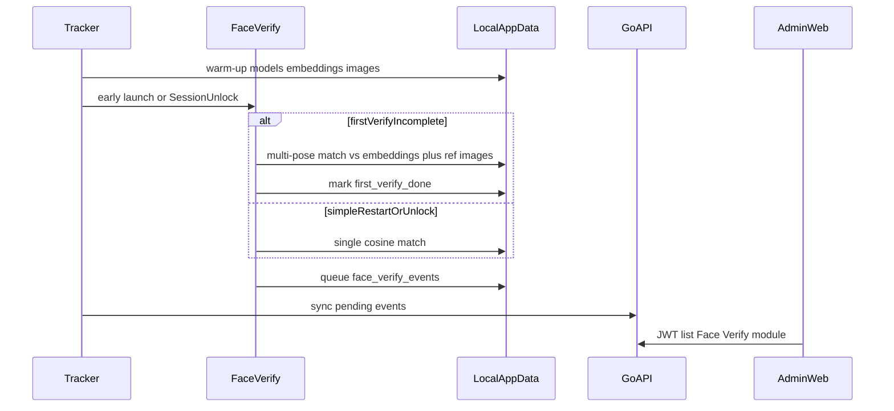

# Face verify — local images, first strong / restart simple, sync + web module

## Locked defaults (from your 4 asks)

- **Images + embeddings** both cached under LocalAppData for offline verify.
- **First verify on this PC** = multi-pose wizard (every enrolled angle); modal cannot close until all required poses match.
- **Later opens** (PC restart / Windows unlock) = **simple** single match (front / best-of-templates), still non-dismissible until match.
- **Tracking stays soft** (collectors/sync keep running). The modal is a **hard UI lock** (Topmost, no close) — not a Windows credential-provider lock screen (out of scope).
- **Every detection** (success + throttled failures + per-pose first-verify steps) queues locally and syncs to the server; new admin web module lists them.

## Architecture

## 1. Local storage — images + embeddings

Extend FacePaths.cs / FaceBiometricStore.cs:

- `face/biometric.db` — profiles, embedding vectors, sample index, `first_verify_completed_at`, pending sync queue
- `face/samples/{sampleId}.jpg` — enrollment JPEGs from DeviceAuth
- `face/models/*.onnx` — YuNet + AdaFace (unchanged)

**Server (new DeviceAuth):**

- `GET /api/v1/face-profiles/me/samples` — list active sample meta (`sampleId`, `poseId`, content hash/size)
- `GET /api/v1/face-profiles/me/samples/:sampleId/image` — stream that employee’s image only (reuse JWT sample ServeContent path; scoped to DeviceAuth `employee_id`)

**Tracker warm-up** (after login / StartTracking): ensure models + embeddings + sample images (skip if hash matches). Modal hot path stays local-only when cache is warm.

## 2. First-time strong verify (every angle)

When `first_verify_completed_at` is null for this employee on this machine:

1. Open modal from local cache (early launch still applies).
2. Wizard steps = enrolled local `pose_id`s (same set as face-enrollment.ts `FACE_POSES` that exist in templates).
3. Each step: prompt + optional **local reference thumbnail**; live camera must match **that pose’s embedding**.
4. On each pose success: local event `mode=first`, `poseId`, score; advance.
5. When all poses pass: set `first_verify_completed_at`, allow close, sync events.

If cache empty: “Meet HR / open tracker once to sync face data” + Retry (local reload); tracker warm-up fills cache.

## 3. Restart / unlock — simple verify

Triggers (Windows):

- Early `--face-verify` on `--background` boot (fast open when cache warm).
- SystemEventWatcher.Windows.cs `SessionUnlock` → `FaceVerifyLauncher` (mutex prevents doubles).

When first verify is done: single continuous match (prefer `front` / `front_return`, else max over templates); non-dismissible until match; then queue event `mode=simple`, `trigger=boot|unlock`.

## 4. Sync every detection + web module

**Client:** `local_face_verify_events` queue in biometric.db; drain via DeviceAuth batch `POST /face-profiles/verify-events/sync` (idempotent `clientEventId`).

**Server:** new migration `face_verify_events` (queryable; do not rely on enrollment audit for the UI). JWT `GET /face-verify/events` (paginated filters: employee, date, result, mode).

**Web:** RBAC `users/face-verify`, route `/face-verify`, sidebar + infinite-scroll table + detail drawer; seed in rbac_service.go with matching sidebar `module` key.

## 5. Keep from prior fast plan

- Early launch before `Host.Build` for ~2s open when cache warm.
- Modal local-only on open; tracker owns network warm-up.
- Soft tracking; hard modal close gate.
- Client VERSION **2.0.9**; AGENTS + ARCHITECTURE.

## Out of scope

- Windows lock-screen credential provider / pre-login face unlock
- Hard-stopping collectors until verify
- Attendance clock-in from face
- Linux face-verify

## Verify

- Warm cache → first wizard all poses → `first_verify_completed_at` + events in web module
- Reboot / unlock → simple modal, one match closes, `mode=simple` synced
- Offline queue then sync when online
- `dotnet build` client; `go build`/`go vet`; `npx tsc --noEmit`
